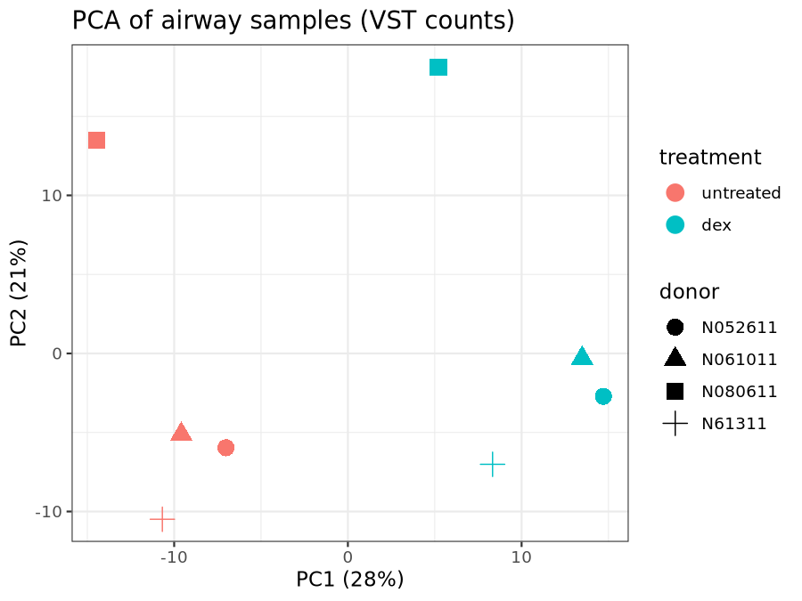
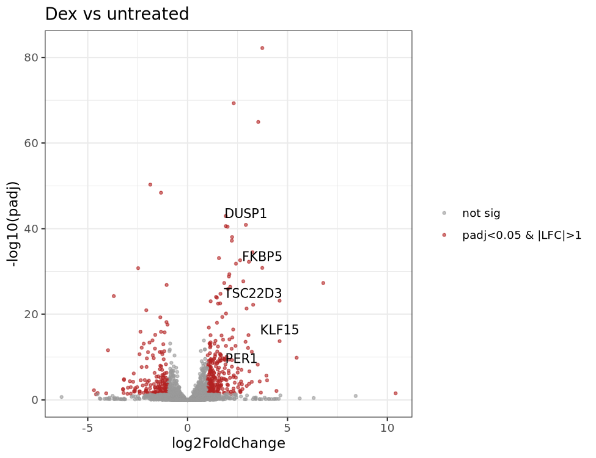
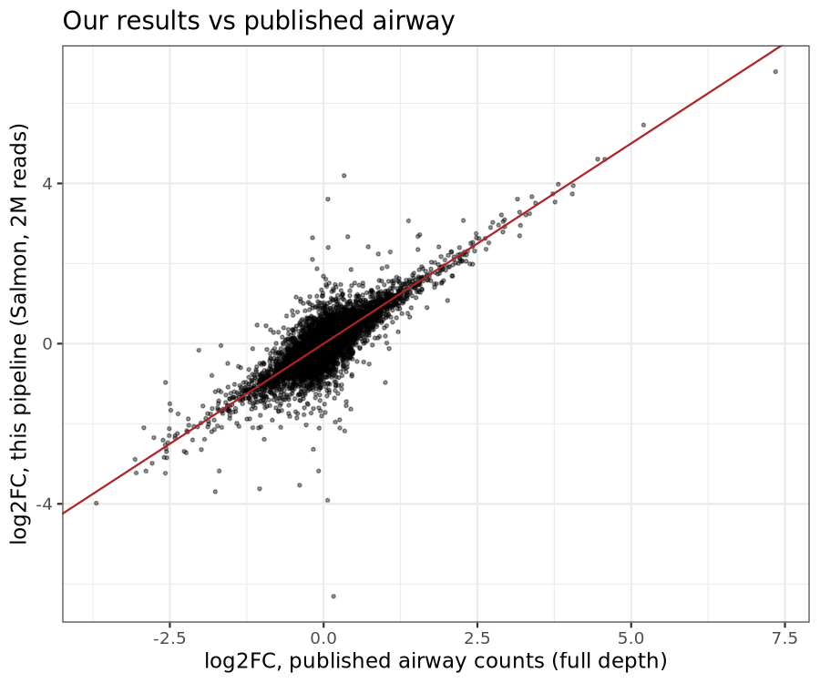

# FASTQ to counts: an RNA-seq pipeline validated on the airway dataset

A complete, reproducible bulk RNA-seq workflow, from raw sequencing reads to differential expression, run on a Windows laptop (WSL2 Ubuntu, 7.6 GB RAM).

**Result:** the pipeline reproduces the published dexamethasone response in human airway smooth muscle cells. 97.3% of the genes it calls significant are also significant in the published analysis, and all 803 shared hits change in the same direction, using about 10% of the original sequencing depth.

## Dataset

- **Study:** Himes et al. (2014), *PLoS ONE* 9(6): e99625. GEO [GSE52778](https://www.ncbi.nlm.nih.gov/geo/query/acc.cgi?acc=GSE52778).
- **Samples:** 4 primary human airway smooth muscle cell lines (donors), each untreated or treated with dexamethasone (dex, 1 µM, 18 h). 8 samples in total; the design is in `data/samples.tsv`.
- **Reads:** Illumina paired-end, 63 bp. To fit a laptop, the first 2,000,000 read pairs of each sample were used (about 10% of the full depth).

## Pipeline

| Phase | Step | Tool | Script |
|---|---|---|---|
| 3 | Download reads (2M pairs per sample) | sra-tools `fastq-dump` 3.4.1 | `scripts/download.sh` |
| 4 | Quality control | FastQC 0.13.0, MultiQC 1.35 | `scripts/qc.sh` |
| 5 | Build transcriptome index (GENCODE v50) | Salmon 2.11.0 | `scripts/reference.sh` |
| 5 | Quantify transcripts | Salmon 2.11.0 (selective alignment) | `scripts/salmon_quant.sh` |
| 6 | Transcript-to-gene table | bash / awk | `scripts/make_tx2gene.sh` |
| 6 | Gene-level import and differential expression | tximport, DESeq2 (R 4.4) | `scripts/deseq2.R` |
| 7 | Figures | DESeq2, ggplot2 | `scripts/plots.R` |
| 7 | Validation against published counts | Bioconductor `airway` | `scripts/compare_airway.R` |

## Results

### Quality control
All samples had mean Phred scores above 30, adapter content below about 1% and GC content of 48–50%. No trimming was needed. Report: `qc/multiqc_report.html`.

### Quantification
Salmon mapped 94.8–96.5% of reads in every sample (`results/mapping_rates.txt`), with library type detected as IU (inward-facing, unstranded paired-end).

### Differential expression (dex vs untreated)
Design: `~ donor + treatment`. Each donor contributes one untreated and one dex sample, so including donor removes donor-to-donor differences (a paired analysis). Genes with at least 10 counts in at least 4 samples were kept (11,495 genes).

At padj < 0.05, **846 genes** changed: 520 up and 326 down. Full table: `results/deseq2_dex_vs_untreated.csv`.

Known glucocorticoid-response genes were all strongly induced:

| Gene | log2 fold change | padj |
|---|---|---|
| DUSP1 | 2.92 | 1.3e-41 |
| FKBP5 | 3.74 | 1.5e-31 |
| TSC22D3 | 3.28 | 6.0e-23 |
| KLF15 | 4.61 | 2.0e-14 |
| PER1 | 2.69 | 9.6e-08 |



PC1 (28% of variance) separates dex-treated from untreated samples; PC2 (21%) mainly reflects donor.



### Validation against the published airway counts
The Bioconductor `airway` package holds full-depth counts for the same 8 samples, produced by an independent pipeline (TopHat2 + HTSeq, Ensembl GRCh37.75). The same DESeq2 model was run on those counts and compared gene by gene (`results/compare_airway.txt`):

| Measure | Value |
|---|---|
| Genes tested in both | 10,690 |
| Significant: this pipeline / published | 825 / 3,303 |
| This pipeline's hits confirmed by published | 97.3% |
| Published hits recovered by this pipeline | 24.3% |
| Same direction among shared hits | 803 of 803 |
| Pearson r of log2 fold changes | 0.834 |



**Interpretation.** The genes this pipeline calls significant are almost always confirmed (high precision). It finds about a quarter of the published hits, which is expected with 10% of the reads: weaker and lower-expressed changes need more depth to detect.

## Limitations and next steps
- Only 2M read pairs per sample were used, which limits power for modest or low-expression changes.
- The Salmon index is transcriptome-only (no genome decoys) because of the 7.6 GB RAM limit; a decoy-aware index can reduce spurious mappings.
- Fold changes were not shrunk; `lfcShrink` (e.g. apeglm) would stabilise estimates for low-count genes, which appear as outliers in the volcano plot.
- Next: run the full-depth data, add functional enrichment of the dex-response genes.

## Reproduce

Requires conda (Miniforge) with channels `conda-forge` then `bioconda` (strict priority).

```bash
conda env create -f envs/rnaseq.yml    # download, QC, Salmon
conda env create -f envs/multiqc.yml   # MultiQC
conda env create -f envs/deseq2.yml    # R, tximport, DESeq2, airway

conda activate rnaseq
./scripts/download.sh
./scripts/qc.sh                        # then: conda activate multiqc; multiqc qc --outdir qc
./scripts/reference.sh
./scripts/salmon_quant.sh

conda activate deseq2
./scripts/make_tx2gene.sh
Rscript scripts/deseq2.R
Rscript scripts/plots.R
Rscript scripts/compare_airway.R
```

Large files (FASTQ, reference, Salmon index and output, `.rds`) are excluded by `.gitignore` and are regenerated by the scripts.

## Reference
Himes BE, Jiang X, Wagner P, et al. RNA-Seq transcriptome profiling identifies CRISPLD2 as a glucocorticoid responsive gene that modulates cytokine function in airway smooth muscle cells. *PLoS ONE*. 2014;9(6):e99625.

## Author
Sheriffdeen Babatunde Ogunsola · ORCID [0009-0003-1923-8377](https://orcid.org/0009-0003-1923-8377) · [GitHub](https://github.com/Shefzy0810)
